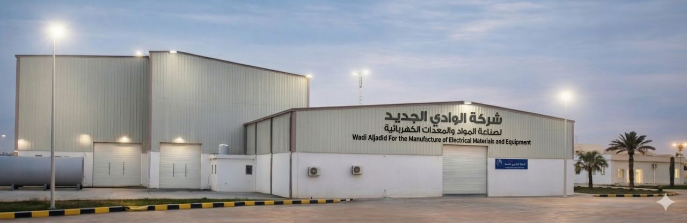
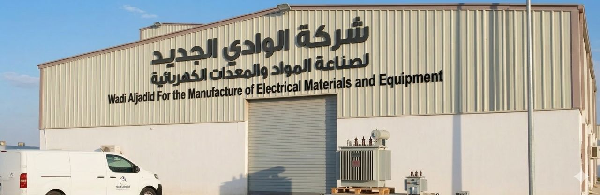
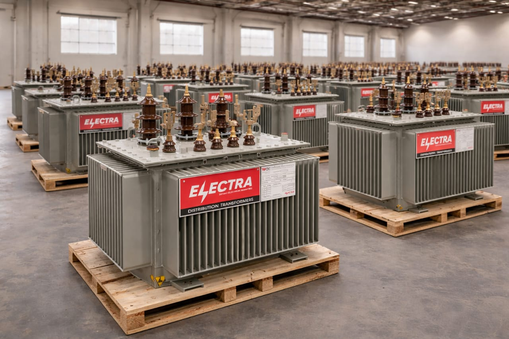

# الموقع الإلكتروني لشركة الوادي الجديد — WADCO Libya

**موقع تعريفي رسمي لشركة الوادي الجديد لصناعة المواد والمعدات الكهربائية، المصنّعة لمحولات التوزيع الكهربائية تحت العلامة التجارية ELECTRA**

Corporate website for Wadi Aljadid For the Manufacture of Electrical Materials and Equipment (WADCO Libya)

> **ملاحظة:** هذا المستودع للعرض والتعريف بالمشروع فقط، ولا يحتوي على الكود المصدري للموقع أو ملفات تشغيله.

---

## نبذة عن المشروع

موقع إلكتروني مؤسسي لشركة **الوادي الجديد لصناعة المواد والمعدات الكهربائية (WADCO Libya)**، يعرّف بالشركة ومنتجاتها وخدماتها الفنية، ويتيح للعملاء والجهات المهتمة التواصل معها مباشرة.

صُمّم الموقع باللغة العربية أولًا وباتجاه الكتابة من اليمين إلى اليسار (RTL)، مع إمكانية التبديل إلى الإنجليزية، ويتضمن لوحة تحكم تتيح للشركة إدارة محتوى الموقع بنفسها.

**رابط الموقع:** ⚠️ ناقص — أضف الرابط إذا كان الموقع منشورًا، أو احذف هذا السطر.
**تاريخ التنفيذ / حالة المشروع:** ⚠️ ناقص

## هدف المشروع

- تقديم هوية رقمية رسمية للشركة تعكس مكانتها في صناعة محولات التوزيع في ليبيا.
- عرض المنتجات والمواصفات الفنية والخدمات بشكل واضح ومنظم.
- تسهيل تواصل العملاء والجهات المهتمة مع الشركة.
- تمكين فريق الشركة من تحديث المحتوى دون الحاجة إلى مطوّر.

## مميزات الموقع

- واجهة عربية بالكامل (RTL) مع زر للتبديل بين العربية والإنجليزية.
- تصميم متجاوب يعمل على الجوال والحاسوب.
- صفحات: الرئيسية، من نحن، الخدمات، المنتجات، المشاريع، العملاء، تواصل معنا.
- نموذج تواصل، مع صفحة في لوحة التحكم لاستعراض الرسائل الواردة.
- زر واتساب ثابت للتواصل السريع.
- لوحة تحكم لإدارة الصفحات والخدمات والمنتجات والمشاريع والعملاء وشرائح الواجهة الرئيسية والوسائط وإعدادات الموقع.

## التقنيات المستخدمة

Next.js 14 · TypeScript · Tailwind CSS · Node.js / Express · Prisma · PostgreSQL

---

## عن الشركة

تأسست شركة الوادي الجديد لصناعة المواد والمعدات الكهربائية سنة **2009**، وهي شركة صناعية ليبية متخصصة في تصنيع وصيانة محولات التوزيع الكهربائية المغمورة بالزيت.

بدأت الشركة نشاطها كأول شركة ليبية في القطاع الخاص تعمل في صيانة وإعادة تأهيل محولات التوزيع، ثم توسعت لتصبح أول مصنع في القطاع الخاص الليبي يصنّع هذه المحولات تحت العلامة التجارية **ELECTRA**.

| | |
|---|---|
| **سنة التأسيس** | 2009 |
| **موقع المصنع** | منطقة سيدي السائح — طرابلس، ليبيا |
| **مساحة المصنع** | حوالي 3 هكتارات، منها حوالي 5000 م² مساحة مغطاة |
| **الطاقة الإنتاجية السنوية** | حوالي 4000 محول توزيع (150 م.ف.أ) |
| **السعات** | حتى 2500 ك.ف.أ |
| **الجهد** | حتى 12 ك.ف (جهد عالٍ) / 0.4 ك.ف (جهد منخفض) |
| **المعيار** | IEC 60076 |

### المنتجات

- **محولات أرضية محكمة الإغلاق:** من 300 حتى 2500 ك.ف.أ
- **محولات أرضية بخزان تمدد:** من 300 حتى 2500 ك.ف.أ
- **محولات هوائية محكمة الإغلاق (للأعمدة):** من 50 حتى 300 ك.ف.أ

### الخدمات

- صيانة محولات التوزيع (دورية وطارئة)
- إعادة التأهيل والتطوير
- الاختبارات الفنية والمعملية
- الخدمات الحقلية والاستشارات الفنية

### العملاء

تُعد الشركة شريكًا استراتيجيًا للشركة العامة للكهرباء في ليبيا، وتخدم كذلك شركات المقاولات الكهربائية والمصانع الكبرى وشركات النفط والغاز ومشروعات البنية التحتية الكهربائية.

---

## صور المشروع

*مبنى مصنع الشركة*

*واجهة المصنع*

*محولات توزيع تحمل العلامة التجارية ELECTRA*

### لقطات من الموقع

⚠️ ناقص — أضف لقطات شاشة من الموقع داخل المجلد `assets/screenshots/` ثم اعرضها هنا.

---

## الحقوق

جميع الحقوق في الاسم التجاري والشعار والعلامة التجارية ELECTRA والصور محفوظة لشركة الوادي الجديد لصناعة المواد والمعدات الكهربائية (WADCO Libya). يُعرض المحتوى هنا لأغراض تعريفية فقط.

**تنفيذ:** ⚠️ ناقص — اسمك أو اسم فريقك، إن رغبت.

